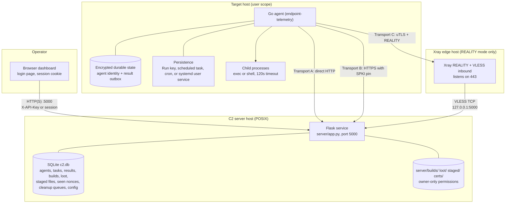
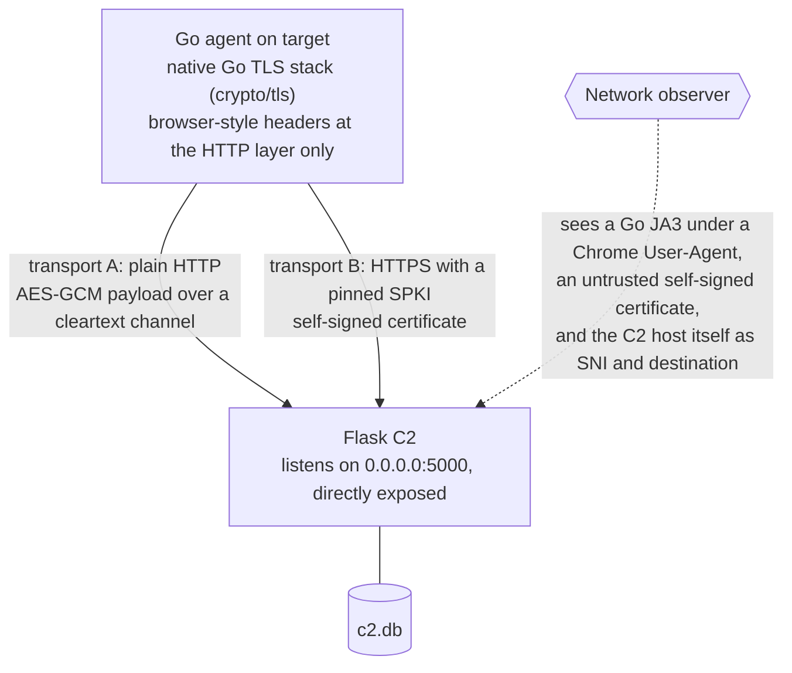
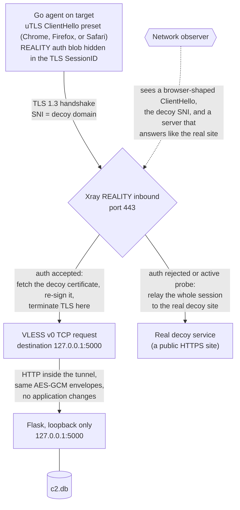
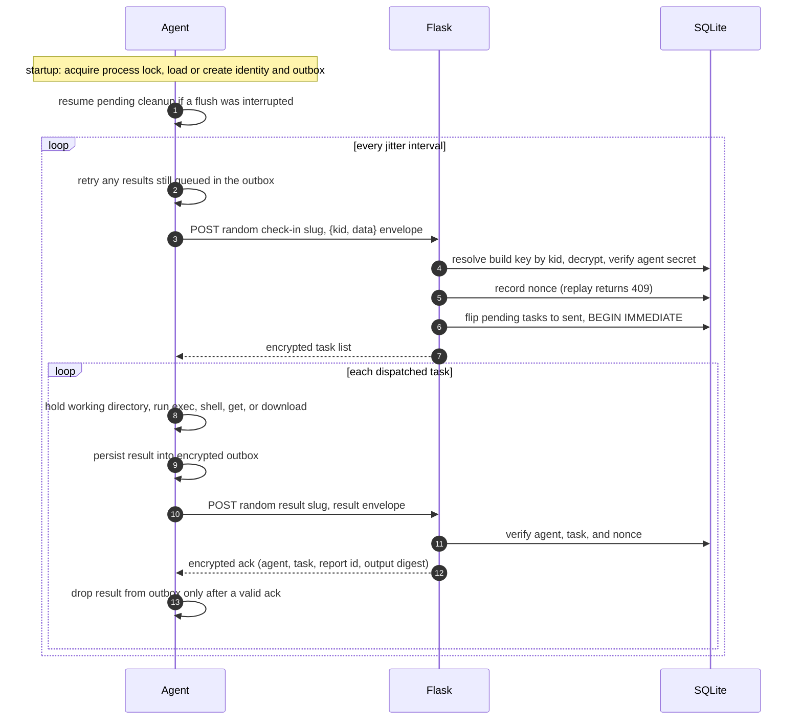
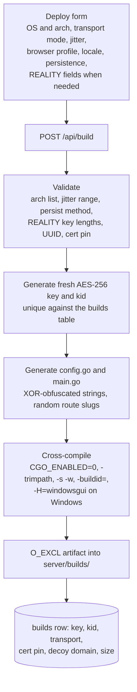
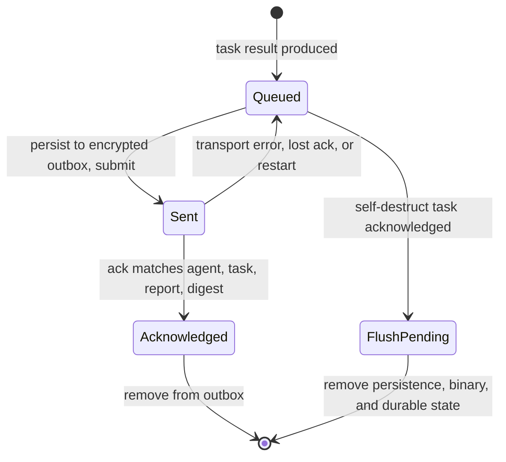

# Architecture

This document explains how the C2 Project fits together. It covers the
components, the transports, the check-in and result lifecycle, the build
pipeline, and the agent's durable result state machine.

## System overview

Three parties: the operator, the C2 server, and the agent on the target host.
In REALITY mode an Xray edge sits between the agent and the server; in direct
HTTP and pinned HTTPS modes the agent reaches the server itself.



Key points:

- All three transports carry the same encrypted application protocol. The choice
  is made at build time.
- In REALITY mode the Xray edge and Flask communicate over loopback, so Flask
  only needs to be reachable from the Xray process. Recent Xray-core releases
  blackhole loopback destinations by default, so the freedom outbound needs the
  `finalRules` allow rule described in `REALITY.md`.
- `c2.db` is the most sensitive file on the server. It holds the operator API
  key, the per-build AES keys, the randomized agent routes, and agent identity
  hashes. Losing it orphans every enrolled agent.

## Before and after REALITY

The two views below are the comparison pair for the blog: how the stack looked
with the original transports, and what REALITY changed.

### Before: direct HTTP and pinned HTTPS

The agent talked straight to Flask. The application payloads were already
AES-256-GCM envelopes, but everything around them identified the traffic as
non-browser and the server as non-ordinary.



### After: REALITY with uTLS and VLESS

The agent now speaks a browser-family ClientHello to an Xray edge, carries the
REALITY proof inside the TLS handshake itself, and only reaches Flask through a
VLESS stream over loopback. The application protocol did not change.



How the agent knows the difference between the REALITY server and the real
decoy: the forged certificate carries an ed25519 public key and an HMAC-SHA512
signature derived from the handshake's shared auth key. A REALITY-authenticated
Xray presents that forged certificate; a fallback or probe presents the decoy's
genuine certificate, which fails the check, and the agent silently retries. In
both directions the failure looks like ordinary browsing.

### What changed, side by side

| | Before (HTTP / pinned HTTPS) | After (REALITY) |
|---|---|---|
| TLS stack | Go crypto/tls | uTLS browser preset |
| ClientHello | distinctive Go fingerprint | matches the claimed browser family |
| Certificate | self-signed, pinned by SPKI | forged from the decoy's real certificate |
| SNI and destination | the C2 host itself | the decoy domain, the C2 is never named |
| Server exposure | Flask on 0.0.0.0:5000 | Flask on loopback behind Xray |
| Probing the server | reaches the C2 application | gets relayed to the real decoy site |
| Failed auth | visible TLS or HTTP error | transparent fallback to the decoy |
| Application protocol | AES-256-GCM {kid, data} envelopes | unchanged |

Deployment note for the after diagram: recent Xray-core releases blackhole
loopback destinations arriving through proxy inbounds, so the freedom outbound
needs the `finalRules` allow rule described in `REALITY.md`.

## Check-in and result lifecycle

The agent beacons on a jittered interval between `JitterMin` and `JitterMax`.
Every request and response is an AES-256-GCM envelope, `{"kid", "data"}`,
where `kid` is the SHA-256 fingerprint of the build key and `data` is
base64(nonce + ciphertext + tag).



Task dispatch is at-most-once: a task is marked `sent` the moment it leaves the
database. If its response is lost, the dashboard shows it as delivery-uncertain
and the operator decides whether to abandon it and issue a replacement.

Agent-side commands with special handling:

- `cd <dir>` changes the working directory for later tasks, and is rejected
  while earlier tasks still depend on it. After a failed change, new tasks that
  use the working directory report an error until a `cd` succeeds.
- `get <path>` uploads a regular file to the server as loot.
- `download <file_id> <path>` fetches a staged file assigned to that task and
  writes it without following a destination symlink.
- `shell` prefix runs a command through `cmd.exe /C` or `/bin/sh -c`; the
  default `exec` mode resolves the binary directly with no shell in the tree.

## Build pipeline

The dashboard Deploy form drives `POST /api/build`. The server compiles in an
isolated temporary directory and never writes intermediate files into the repo.



The operator API key is generated at first startup, printed to the terminal,
and stored in `server_config`; the login session keeps only its SHA-256 hash.
Generated binaries carry build credentials and must be treated as secrets.

## Agent durable result state machine

Results survive restarts. Each result is encrypted with the build key, written
to a fresh generation file, and only removed after the server's encrypted
acknowledgement validates.



The outbox lives under the user config directory, keyed on the build key and the
executable path, protected by a process lock so two copies of the same build
cannot share state. A pending flush resumes after restart, which makes
self-destruct idempotent even if the acknowledgement or the process is lost.

## Repository layout

```text
agent/                     Go agent source and generated-build templates
agent/funcs/reality/       REALITY, uTLS, and VLESS client transport
server/app.py              Flask routes, build pipeline, and operator API
server/database.py          SQLite schema and migrations
server/crypto.py            AES-256-GCM envelope helpers
server/certificate_probe.py Decoy certificate measurement for REALITY
server/certificate_storage.py Atomic TLS certificate bundle publication
server/gen_cert.py          Standalone certificate generation script
server/storage_permissions.py Owner-only permission enforcement
server/static/             Dashboard JavaScript and CSS
server/templates/           Login and dashboard templates
server/tests/              Dashboard test harness and UI tests
TODO.md                    Detection-surface tracker
REALITY.md                 REALITY transport guide and Xray setup
```
